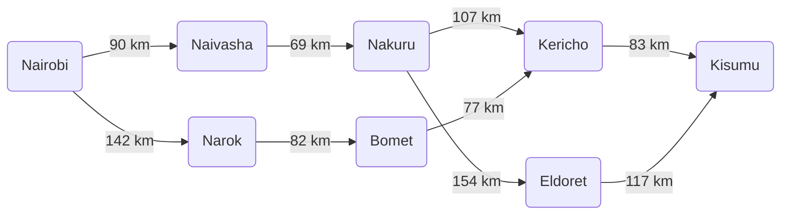

## 2. Directed Graph and Search Tree

### Application of Abstraction
To map the environment effectively, we applied the concept of abstraction by simplifying the complex physical world into a manageable state space. Instead of mapping every curve and minor village, we abstracted the environment by restricting our nodes to major highway junction towns across the Nairobi, Central Highlands, Rift Valley, and Lake Victoria Basin regions. The links between these states are straight, directed edges, and the continuous real-world driving conditions are abstracted into a single path cost: driving distance in kilometers.

### Directed Graph Representation
*(Note: As per assignment instructions, handwritten diagrams are not included. The graph below maps the primary routes flowing outward from Nairobi to Kisumu).*



### Search Tree Representation

```mermaid
graph TD
    Root[Nairobi: 0 km] --> N1[Naivasha: 90 km]
    Root --> N2[Narok: 142 km]
    
    N1 --> N3[Nakuru: 159 km]
    N2 --> N6[Bomet: 224 km]
    
    N3 --> N4[Kericho: 266 km]
    N3 --> N5[Eldoret: 313 km]
    
    N6 --> N7[Kericho: 301 km]
    
    N4 --> Goal1((Kisumu: 349 km))
    N5 --> Goal2((Kisumu: 430 km))
    N7 --> Goal3((Kisumu: 384 km))
